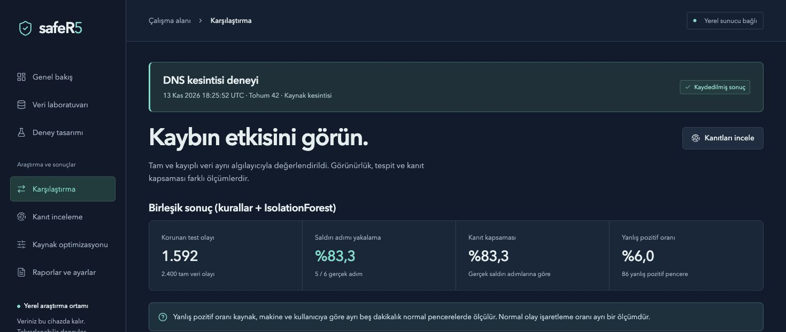
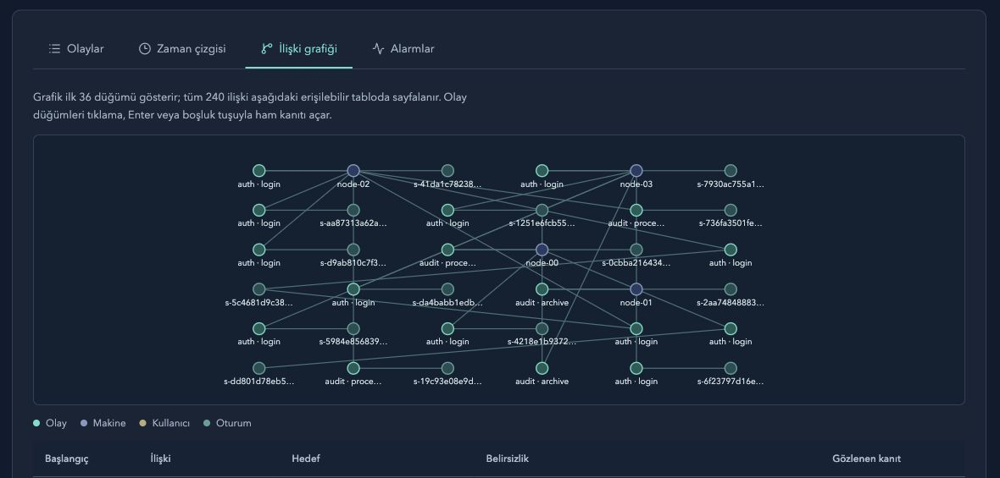
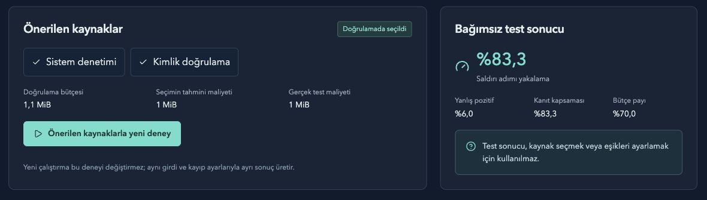
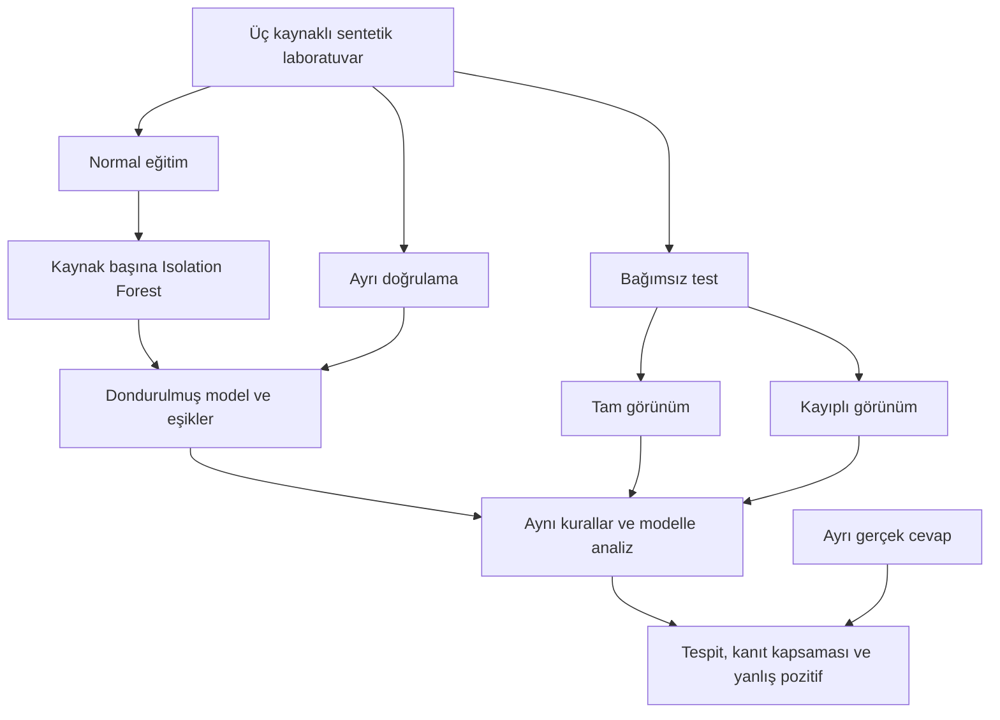

# safeR5

**Güvenlik kayıtları eksildiğinde hangi saldırı adımlarını artık göremiyoruz?**

safeR5, kayıt kaybının saldırı tespiti ve kanıt görünürlüğü üzerindeki etkisini ölçen yerel bir siber güvenlik araştırma laboratuvarıdır. Kimlik doğrulama, sistem denetimi ve DNS kayıtlarının tam ve kayıplı görünümlerini **aynı kurallar, model ve karar eşikleriyle** karşılaştırır. Sınırlı kayıt bütçesinde hangi kaynak birleşiminin daha yararlı olduğunu da ayrı bir testte ölçer.

[Deney sonucu](#örnek-deney-dns-kesintisi) · [Ekran görüntüleri](#uygulama-ekran-görüntüleri) · [Hızlı başlangıç](#hızlı-başlangıç) · [Deney yöntemi](#deney-yöntemi) · [Komut satırı](#komut-satırından-çalıştırma) · [Doğrulama](#doğrulama-ve-sınırlar)

## Araştırma sorusu

Bir log toplama hattı kesildiğinde veya belirli kayıtları saklamak mümkün olmadığında, alarm sayısı tek başına kaybın etkisini açıklamaz. Daha az alarm, daha az yanlış uyarı anlamına gelebileceği gibi, saldırıyı görünür kılan olayların kaybolduğunu da gösterebilir.

safeR5 üç soruyu ayrı ayrı ele alır:

1. **Görünürlük:** Gerçek saldırı adımlarının kaçında en az bir kayıt hâlâ görülebiliyor?
2. **Tespit:** Bu adımların kaçı gözlenen kanıtıyla bir alarma bağlanabiliyor?
3. **Kaynak bütçesi:** Belirlenen veri miktarı ve yanlış pozitif sınırında hangi kayıt kaynaklarını birlikte tutmak daha yararlı?

Bu ayrım, sentetik verinin gerçek cevabı bilindiği için ölçülebilir. Kayıp uygulandığında gözlenemeyen adımlar gerçek cevaptan çıkarılmaz.

## Örnek deney: DNS kesintisi

Tohum `42` ile üretilen sentetik testte üç kaynak açıkken 2.400 olay incelendi. İkinci kolda 808 DNS kaydı analiz görünümünden çıkarıldı. Kimlik doğrulama ve sistem denetimi kayıtları ile algılama yöntemi aynı kaldı.

| Ölçüm | Tam görünüm | DNS kayıtları olmadan |
| :--- | ---: | ---: |
| Gözlenen test olayı | 2.400 | 1.592 |
| Görünen DNS kaydı | 808 | 0 |
| Yakalanan gerçek saldırı adımı | 6 / 6 | 5 / 6 |
| Kanıt kapsaması | %100 | %83,3 |
| Üretilen alarm | 132 | 101 |
| İşaretlenen / gözlenen normal pencere | 114 / 2.181 | 86 / 1.445 |
| Normal pencere yanlış pozitif oranı | %5,2 | %6,0 |

Bu çalıştırmada bir gerçek adımın görünür kanıtı kayboldu. Alarm sayısı azalırken yanlış pozitif oranı yükseldi; çünkü işaretlenen normal pencere sayısıyla birlikte gözlenen normal pencere sayısı da değişti. **Bu tablo, tek bir sentetik deneyin sonucudur.** Farklı tohum, veri kümesi veya kayıp ayarları farklı sonuçlar verebilir.

## Uygulama ekran görüntüleri

Görüntüler, tohum `42` ile çalıştırılan sentetik DNS kesintisi deneyinde uygulamanın arayüzünden alındı.

### DNS kesintisi karşılaştırması



*Tam ve kayıplı görünüm aynı algılayıcıyla ölçülüyor. Kayıplı görünümde adım yakalama ve kanıt kapsaması %83,3.*

### Kanıt ilişkileri



*Grafik, kayıptan sonra görünür kalan olayların ilişkilerini gösteriyor. Olay düğümünden ham kayıt satırına gidilebiliyor.*

### Kaynak optimizasyonu



*%70 veri bütçesinde doğrulamada sistem denetimi ve kimlik doğrulama seçildi. Seçilen kaynaklarla yapılan bağımsız testte saldırı adımı yakalama %83,3.*

## Hızlı başlangıç

**Gereksinimler:** Python 3.12 veya 3.13, Node.js 22.12 veya üzeri ve npm. Kurulum, sistemde varsa `uv` kullanır. İlk kurulum bağımlılıkları indirmek için internet gerektirebilir.

macOS’ta kurulum:

```sh
git clone https://github.com/levahley/safeR5.git
cd safeR5
sh scripts/setup.sh
sh scripts/start.sh
```

Özel depoyu klonlamak için GitHub hesabınızın okuma erişimi olmalıdır. Kurulum Python ortamını hazırlar ve arayüzü derler. Uygulama [127.0.0.1:8765](http://127.0.0.1:8765) adresinde açılır; çalışma sırasında dış API veya bulut hesabı gerektirmez. Deney verileri varsayılan olarak `data/` klasöründe tutulur.

### Arayüzde ilk karşılaştırma

1. **Genel bakış → Demo deneyi başlat.** Bu ilk deney kayıpsızdır. İş tamamlanınca **Sonucu aç** ile karşılaştırmayı inceleyin.
2. **Deney tasarımı** ekranında aynı veri kümesini seçin ve üç kaynağı açık bırakın. **Kaynak kesintisi → DNS** seçip **Deneyi çalıştır** düğmesine basın.
3. **Karşılaştırma** ekranında olay sayılarını, yakalanan adımları ve normal pencere yanlış pozitif oranını okuyun. **Yöntemlerin ayrı sonuçları** tablosunda kuralları ve Isolation Forest’ı karşılaştırın.
4. **Kanıt inceleme** ekranında bir alarmın olaylarına ve özgün kayıt satırına dönün. Zaman çizgisi ve ilişki grafiği, gözlenen kayıtlar arasındaki bağı incelemek için kullanılabilir.
5. **Kaynak optimizasyonu** ekranında bütçe, adaylar ve bağımsız test sonucunu kontrol edin. **Raporlar ve ayarlar** ekranından sonucu JSON, CSV, Markdown veya HTML olarak indirin.

Sunum için adım adım akış: [Beş dakikalık demo](docs/DEMO.md).

## Deney yöntemi



### Veri kaynakları ve senaryolar

| Kaynak | Örnek olaylar | Analize katkısı |
| :--- | :--- | :--- |
| `auth` · Kimlik doğrulama | Başarılı ve başarısız oturum açmalar | Hesap ve oturum davranışı |
| `audit` · Sistem denetimi | Ayrıcalıklı işlem, uzak çalıştırma ve arşivleme | Bir makinede gerçekleşen işlemler |
| `dns` · DNS | Sorgu adı ve varsa bayt bilgisi | Ağ etkinliğine ait gözlenen izler |

Laboratuvar **hesap kötüye kullanımı**, **sunucular arası ilerleme** ve **veri sızdırma belirtileri** için olay dizileri üretir. Normal yedekleme, ayrıcalıklı bakım ve yoğun DNS etkinliği de veri içinde bulunabilir. Böylece tek bir işlem türü doğrudan saldırı etiketi hâline gelmez.

Varsayılan kümede eğitim, doğrulama ve test için **ayrı ayrı 2.400 olay** üretilir: toplam 7.200 olay. Bölümlerin tarihleri ve rastgele dizileri ayrıdır. Doğrulama ve test aynı senaryo ailelerini farklı yerleşimlerde içerir; bu nedenle sonuç görülmemiş saldırı ailelerine genelleme testi olarak okunmamalıdır.

### Kurallar ve makine öğrenmesi

Olaylar **kaynak, makine, kullanıcı ve beş dakikalık zaman dilimi** temelinde gruplanır. Olay hacmi, başarısız giriş oranı, ayrıcalıklı işlem sıklığı, DNS sorgu uzunluğu ve farklı hedef sayısı gibi sayısal özellikler çıkarılır.

- **Kurallar**, başarısız girişlerin ardından başarılı giriş veya kısa sürede farklı makinelerde oturum hareketi gibi tanımlı örüntüleri arar.
- **Isolation Forest**, her kaynak için normal eğitim pencerelerinde öğrenen 64 ağaçlı bir anomali modelidir. Ön işleme adımları da yalnız eğitim verisinde öğrenilir.
- **Eşik**, ayrı doğrulama pencerelerinin skorlarından alınan 95. yüzdeliktir. Skor bir saldırı olasılığı değildir; yüzdelik de tespit başarısını ifade etmez.
- **Karşılaştırma**, model, ön işleme ve eşikler sabitlenerek yapılır. Tam ve kayıplı kollar aynı deneyde aynı modeli kullanır.

Nihai alarm kümesi kurallar ve modelden gelen alarmların birleşimidir. Arayüz her yöntemin ölçümünü ayrıca gösterir. Gerçek saldırı cevabı, algılayıcıya özellik olarak verilmez; sonuçları değerlendirmek için kullanılır.

### Kayıp modelleri ve ölçümler

| Kayıp modeli | Uygulama |
| :--- | :--- |
| Rastgele kayıp | Tohum ve olay kimliğine bağlı olarak belirlenen olaylar görünümden çıkarılır. |
| Kaynak kesintisi | Seçilen kaynağın kayıtları tamamen veya belirtilen zaman aralığında kaldırılır. |
| Zaman aralığı kaybı | Tüm kaynakların belirlenen aralığa denk gelen olayları kaldırılır. |

Kayıp, test verisinin ayrı bir görünümüne uygulanır. Özgün kayıtlar ve gerçek cevap korunur. DNS kaybı gerçek DNS hizmetini kapatmaz.

| Ölçüm | Hesap |
| :--- | :--- |
| **Saldırı adımı yakalama** | Gözlenen kanıtıyla alarma bağlanan gerçek adımlar / tüm gerçek adımlar |
| **Kanıt kapsaması** | En az bir olayı görünür kalan gerçek adımlar / tüm gerçek adımlar |
| **Yanlış pozitif oranı** | Alarm kanıtıyla işaretlenen normal pencereler / gözlenen normal pencereler |
| **Ortalama tespit gecikmesi** | Yakalanan adımlarda, adım başlangıcından ilk eşleşen alarm zamanına kadar geçen süre |

Gecikme, toplu analizde kullanılan olay ve gözlenme zamanlarına dayanır. Normal pencere yoksa yanlış pozitif oranı ölçülmez. [Yöntem belgesi](docs/METHODOLOGY.md) eşleştirme kurallarını ve boş değerlerin anlamını açıklar.

### Veri bütçesinde kaynak seçimi

Üç kaynağın, boş küme dahil **sekiz altkümesi** doğrulama verisinde değerlendirilir. Bütçe ve yanlış pozitif sınırını aşan adaylar elenir. Uygun adaylar önce saldırı adımı yakalamaya, eşitlikte daha düşük yanlış pozitif oranına ve ardından daha düşük veri maliyetine göre sıralanır.

Maliyet, normalleştirilmiş olayların UTF-8 JSON satırlarıyla ölçülür. Seçilen altküme değiştirilmeden test bölümünde değerlendirilir. Bu bağımsız kaynak testi, deneyin ek kayıt kaybını uygulamaz. Öneriyle yeni deney başlatıldığında ise önceki kayıp ayarları taşınır.

## Komut satırından çalıştırma

Kurulum tamamlandıktan sonra proje kökünde aşağıdaki komut **DNS kesintisi deneyini** çalıştırır. Yapılandırma kendi sentetik veri kümesini oluşturur.

```sh
PYTHONPATH=backend/src .venv/bin/python -m safer5 --root data \
  experiment run --config configs/demo.json
```

Çıktıdaki `id` değerini sonraki komutlarda `DENEY_KIMLIGI` yerine yazın:

```sh
PYTHONPATH=backend/src .venv/bin/python -m safer5 --root data \
  evaluate --experiment DENEY_KIMLIGI

PYTHONPATH=backend/src .venv/bin/python -m safer5 --root data \
  report --experiment DENEY_KIMLIGI --format html --output work/rapor.html
```

Yapılandırma örneği: [configs/demo.json](configs/demo.json). Ayrı veri kümesi üretme, tohum seçimi ve manifest doğrulama için [laboratuvar rehberine](docs/LAB.md) bakın.

## Teknik yapı ve izlenebilirlik

| Katman | Uygulama | Görev |
| :--- | :--- | :--- |
| Arayüz | React, TypeScript, Vite | Deney ayarları, metrikler, kanıt grafiği ve raporlar |
| API ve iş yürütme | Python, FastAPI | Yerel deney kuyruğu, iş durumu ve sonuç sorguları |
| Algılama | Kurallar, scikit-learn | Olay özetleri, anomali skoru ve alarm üretimi |
| Veri katmanı | Parquet, DuckDB, SQLite | Olay sorguları, deney çıktıları ve kalıcı iş bilgileri |

`frontend/` arayüzü, `backend/src/safer5/` deney ve analiz kodunu, `backend/tests/` davranış testlerini, `scripts/` kurulum ve doğrulama araçlarını içerir.

Bir deney sonucunda yapılandırma, tohum, kaynak kodu, girdi, model ve kayıp görünümüne ait özetler saklanır. Kanıt kaydı, özgün dosyanın kimliğini, fiziksel satır numarasını ve SHA-256 özetini taşır. Bu bilgiler raporda görülen bir sonucun hangi girdiye dayandığını takip etmeyi sağlar. İlişki grafiği gözlenen bağları gösterir; tek başına bir saldırının nedenini veya failini belirlemez.

## Doğrulama ve sınırlar

- **17 Ekim 2026 yerel doğrulaması:** 57 backend ve 24 arayüz testi geçti. Ana deney akışı, kanıt inceleme ve rapor indirme gerçek Chrome’da denendi.
- **Hacim deneyi:** Toplam 300.000 sentetik olay üretildi; ayrı test bölümünde 100.000 olay analiz edildi. Bu çalıştırmada 6/6 adım yakalandı ve normal pencere yanlış pozitif oranı %37,4 olarak ölçüldü. Yüksek yakalama oranı tek başına düşük yanlış alarm anlamına gelmez.
- **20 Ekim 2026 başlatma kontrolü:** Python açılış hatası, dolu port ve boş port için üç ayrı regresyon testi geçti.

Sonuçlar kontrollü sentetik koşullara aittir. İçe aktarılan etiketsiz JSONL olayları incelenebilir; gerçek cevap yoksa tespit başarısı ve kaynak önerisi hesaplanmaz. Windows, Docker çalışma ortamı ve gerçek AIT arşivi için uçtan uca doğrulama tamamlanmamıştır. Ayrı Playwright çalıştırıcısının durumu da [doğrulama kaydında](docs/VALIDATION.md) belgelenmiştir.

| Belge | İçerik |
| :--- | :--- |
| [Ölçüm yöntemi](docs/METHODOLOGY.md) | Veri bölümleri, model, kayıp türleri ve metrikler |
| [Laboratuvar rehberi](docs/LAB.md) | Veri üretimi, CLI ve saklanan deney dosyaları |
| [API sözleşmesi](docs/API_CONTRACT.md) | Uç noktalar ve yanıt modelleri |
| [Doğrulama kaydı](docs/VALIDATION.md) | Yapılan kontroller, ölçümler ve açık kalan doğrulamalar |
| [Bilinen sınırlar](docs/LIMITATIONS.md) · [Tehdit modeli](docs/THREAT_MODEL.md) | Kullanım kapsamı ve güvenlik varsayımları |
