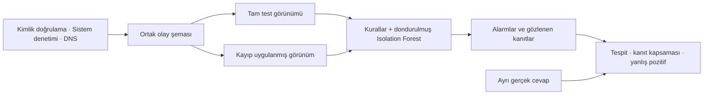

# safeR5

**Kayıt kaybı saldırı tespitini ne kadar değiştirir?**

safeR5, güvenlik kayıtlarının bir bölümü kaybolduğunda hangi saldırı adımlarının ve kanıtların görünmez kaldığını ölçen yerel bir siber güvenlik araştırma laboratuvarıdır. Aynı test verisinin tam ve kayıplı görünümlerini **aynı kurallar ve eğitilmiş modelle** karşılaştırır.

[Hızlı başlangıç](#hızlı-başlangıç) · [Deney sonucu](#örnek-deney-dns-kesintisi) · [Yöntem](docs/METHODOLOGY.md) · [Doğrulama](docs/VALIDATION.md)

## Örnek deney: DNS kesintisi

Üç kayıt kaynağıyla oluşturulan sentetik testte DNS kayıtları deneyin ikinci kolundan çıkarıldı. Aşağıdaki değerler, tohum 42 ile kaydedilmiş tek bir çalıştırmaya aittir.

| Ölçüm | Tam veri | DNS kayıtları olmadan |
| :--- | ---: | ---: |
| Gözlenen test olayı | 2.400 | 1.592 |
| Yakalanan gerçek saldırı adımı | 6 / 6 | 5 / 6 |
| Kanıt kapsaması | %100 | %83,3 |
| Normal pencerelerde yanlış pozitif oranı | %5,2 | %6,0 |

**Bu deneyde 808 kayıt ve bir saldırı adımının görünür kanıtı kayboldu.** Gizlenen adım değerlendirme paydasında kaldığı için tespit oranı, kaybın etkisini yansıtır.

## Nasıl çalışır?



- **Veri laboratuvarı:** Normal bakım örnekleriyle birlikte hesap kötüye kullanımı, sunucular arası ilerleme ve veri sızdırma belirtisi senaryoları üretir. Varsayılan veri kümesinde eğitim, doğrulama ve test bölümlerinin her biri 2.400 olay içerir.
- **Makine öğrenmesi:** Her kaynak için ayrı bir 64 ağaçlı Isolation Forest modeli, normal eğitim verisindeki beş dakikalık pencere özetlerinden öğrenir. Alarm eşiği ayrı doğrulama skorlarının 95. yüzdeliğidir. Bu eşik bir başarı oranı değildir.
- **Kayıp deneyleri:** Rastgele kayıt kaybı, bir kaynağın kesilmesi ve belirli bir zaman aralığının kaybı özgün kayıtlar korunarak uygulanır. Kuralların ve modelin sonuçları ayrı ve birleşik gösterilir.
- **Kaynak seçimi:** Üç kaynağın sekiz altkümesi, veri bütçesi ve yanlış pozitif sınırı altında doğrulamada denenir. Seçim ayrı test bölümünde ölçülür.
- **Kanıt ve raporlama:** Alarmın dayandığı gözlenen olaylar zaman çizgisi, ilişki grafiği ve ham satır üzerinden incelenebilir. Sonuçlar JSON, CSV, Markdown ve HTML olarak alınabilir.

## Hızlı başlangıç

**Gereksinimler:** Python 3.12 veya 3.13, Node.js 22.12 veya üzeri. Kurulum, varsa `uv` kullanır.

Depoyu klonladıktan sonra proje klasöründe:

```sh
sh scripts/setup.sh
sh scripts/start.sh
```

1. [Yerel arayüzü](http://127.0.0.1:8765) aç ve **Demo deneyi başlat** düğmesine bas.
2. **Deney tasarımı** ekranında aynı veri kümesini seç. **Kaynak kesintisi → DNS** ile yeni deney çalıştır.
3. **Karşılaştırma** ekranında tespiti ve kanıt kapsamasını karşılaştır. **Kanıt inceleme** ekranında bir alarmın ham kayıt satırını aç.

İlk kurulum paketleri indirmek için internet isteyebilir. Uygulama yerel çalışır; hesap, ücretli API veya bulut hizmeti gerektirmez.

## Teknik yapı

| Katman | Teknoloji |
| :--- | :--- |
| Türkçe arayüz | React · TypeScript · Vite |
| API ve deney işçisi | Python · FastAPI |
| Anomali tespiti | scikit-learn · Isolation Forest |
| Olay sorguları ve kalıcı durum | Parquet · DuckDB · SQLite |

**Doğrulama:** 17 Ekim 2026 yerel doğrulamasında 57 backend ve 24 arayüz testi geçti; ana demo akışı Chrome’da doğrulandı. Hacim deneyinde 300.000 sentetik olay üretildi ve 100.000 test olayı analiz edildi. Ayrıntılar [doğrulama kaydında](docs/VALIDATION.md).

**Kapsam:** safeR5 eğitim ve kontrollü deneyler içindir. Sentetik sonuçlar üretim ağı başarısını göstermez. Etiketsiz JSONL olayları incelenebilir, ancak bu veri için tespit başarısı veya kaynak önerisi hesaplanmaz. Windows, Docker çalışma ortamı ve gerçek AIT arşivi henüz doğrulanmadı.

[Laboratuvar rehberi](docs/LAB.md) · [Beş dakikalık demo](docs/DEMO.md) · [Sınırlar](docs/LIMITATIONS.md) · [Tehdit modeli](docs/THREAT_MODEL.md)
